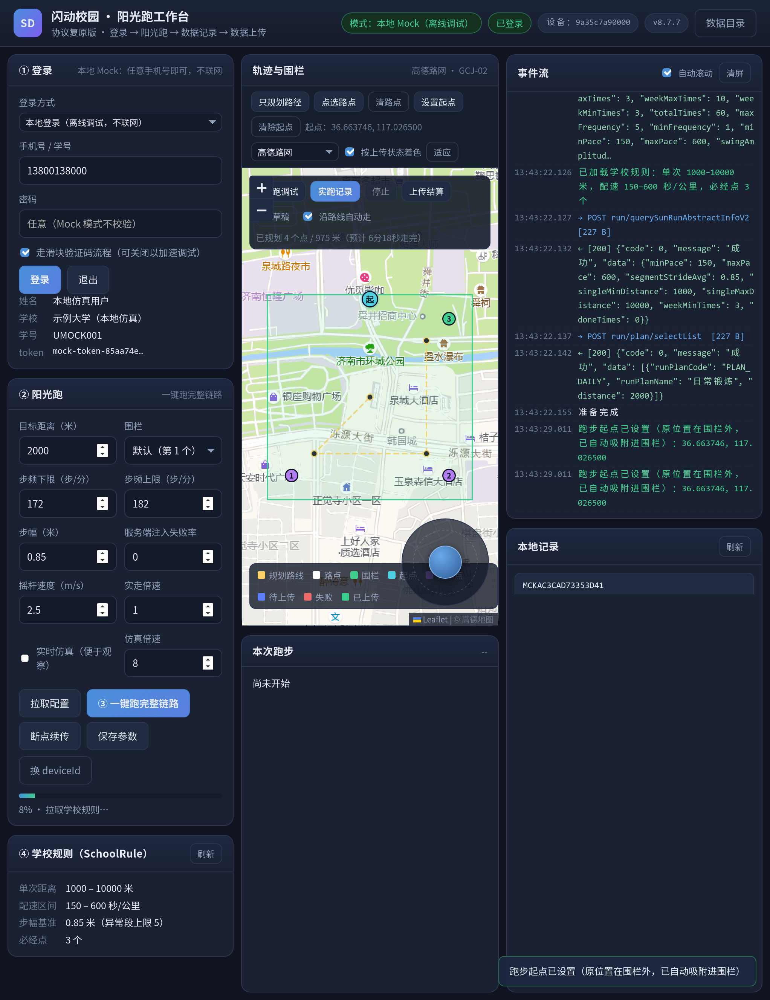
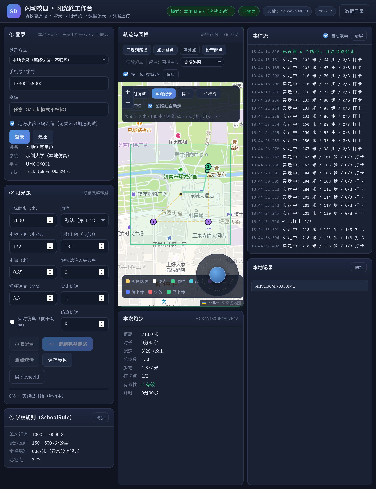

# 闪动校园·阳光跑 桌面工作台（shandong-run-lab）

一个用 Python 重写的**桌面程序**，把「闪动校园」（`com.huachenjie.shandong_school`）阳光跑的整条链路
从 App 里搬出来：**登录 → 选围栏/规则 → 开跑 → 轨迹与步频记录 → 分批上传 → 结算**，
并且内置一套**离线 Mock 服务端**与**传感器仿真器**（移植自 [FUCK-RUN-](https://github.com/BieFan1029/FUCK-RUN-)），
不开手机、不连服务器也能把全流程跑通、看数据、调参数。

界面是本地 Web（HTML/CSS/JS，无构建链），由 **pywebview** 装进原生窗口；没有 pywebview 时自动降级成
「本地 HTTP + 浏览器」，功能完全一致。

> ⚠️ **用途声明**：本项目仅用于**个人学习、协议研究与本地仿真调试**。请勿用于任何
> 影响真实校园跑数据、或与自身无关的账号。默认运行在 **真实模式**（直连 api.huachenjie.com）；想纯本地调试就把登录方式切成「本地登录」。

---

## 一、它能做什么

| 环节 | 能力 |
| --- | --- |
| 登录 | `loginCheck` → 滑块验证码（内置不依赖 OpenCV 的缺口求解）→ `loginPassword`；会话与 deviceId 持久化 |
| 备跑 | 拉学期、围栏列表（多边形）、阳光跑规则（配速/距离/打卡/步幅阈值）、跑量计划，解析成规则对象 |
| 开跑 | 九参数开跑报文，写入本地 SQLite（记录号、打卡点、围栏） |
| 记录 | 轨迹点（3 秒一采）、步频段（20 秒一段）、配速段（50 米一段）、步幅段（100/200 米一段）、打卡点命中，全部落库 |
| 上传 | `uploadRunRecord`（★唯一需签名的接口：整表一次 POST，`state∈{1,4} 且 isValid=1`，总数 ≤ 3 不发）→ 步频段（20 秒一段）/配速段（50 米一段）/步幅段（`strideStatisticsInterval` 米一段，每次只发 1 段）→ 打卡点 |
| 结算 | 完全照搬原版 `DataComponent.t1()` 的 Map：`runRecordCode / duration / distance / totalStep / status / stepInterval / paceInterval / targetPoints / alignType / pauseCount / pauseTimes / sportType`（非空时加 `invalidReasons`）；**不含** pois/stepList/paceList |
| 调试 | Mock 服务端（可注入延迟与随机失败率）、传感器仿真器（步频/抖动/丢包/暂停）、实时仿真（逐点推进，可在界面上看轨迹长出来）、事件流面板、本地记录浏览、JSON/GPX 导出 |
| 地图 | Leaflet 真实底图（高德路网/卫星、OSM、或关闭底图），围栏、打卡点、轨迹、规划路线、**起跑点**矢量叠加；**拉到电子围栏后镜头自动飞到围栏**（围栏换了才动；用户自己拖过镜头之后不再抢镜）；UI 自动验证布局与几何 |
| 手控 | **摇杆实走**（拖动摇杆 / 方向键逐帧推进位置与传感器；推满杆默认 2.5 m/s，可调）；**只规划不动**（按打卡点最近邻连成闭环、或地图上点选路点，只画出来不升跑）；**实跑边跑边落库**（完全按原 App 记录链路：定位回调 3 秒一条、精度/速度过滤、有效点折线累距、步频段 20 秒一段、配速段 50 米一段、打卡半径 25 米），干跑/实跑结束后可一键上传结算 |
| 续传 | 断点续传：只补传「未成功」的点/段，含尾部补齐段 |

---

## 二、安装

需要 Python 3.10+（本机实测 3.14）。Arch Linux：

```bash
# 依赖（大多数系统已自带 requests/cryptography/Pillow）
sudo pacman -S --needed python-requests python-cryptography python-pillow

cd shandong-run-lab
python3 -m venv --system-site-packages .venv       # 继承系统包，省一次下载
.venv/bin/pip install pywebview                    # 桌面窗口（可选，缺了就自动走浏览器）
.venv/bin/pip install pycryptodome                 # 可选，密码学后端更快（没有则用 cryptography）
```

`pycryptodome` / `cryptography` / 纯标准库三种密码学后端会自动择优（见 `sdlab/ciphers.py`），
**全部缺失也能跑**（内置纯 Python AES）。

## 三、运行

```bash
# ① 桌面窗口（默认命令；真实模式，登录卡片里可切本地登录）
.venv/bin/python -m sdlab

# ② 不开窗口，用浏览器（端口随机，终端会打印地址）
.venv/bin/python -m sdlab gui --browser

# ③ 命令行跑一次完整流程（不开界面，适合脚本化 / 排错）
.venv/bin/python -m sdlab run -d 2000            # 2000 米
.venv/bin/python -m sdlab run -d 1500 --no-upload --json | tail -40

# ③′ 实时仿真：按真实时间推进数据写入，能在界面上看到轨迹一笔笔长出来（调试友好）
#     默认关闭（瞬间算完）。倍速 8 ≈ 真实跑步耗时的 1/8。
.venv/bin/python -m sdlab run -d 1200 --realtime --speed 8
# ④ 只起 Mock 服务端（给别的东西当靶子）
.venv/bin/python -m sdlab mock --port 8899 --latency 200 --fail-rate 0.3

# ⑤ 其它
.venv/bin/python -m sdlab info                   # 环境信息（后端、数据目录、默认目标）
.venv/bin/python -m sdlab login --prepare        # 登录并拉围栏/规则
.venv/bin/python -m sdlab records list           # 本地记录
.venv/bin/python -m sdlab records show --points  # 明细（含轨迹点）
.venv/bin/python -m sdlab records export MCKXXXX --format gpx
.venv/bin/python -m sdlab records resume MCKXXXX # 断点续传
.venv/bin/python -m sdlab start-point          # 看当前跑步起点（围栏中心 / 图上选的）
.venv/bin/python -m sdlab start-point --lat 36.6637 --lng 117.0265   # 设起点（围栏外自动吸附）
.venv/bin/python -m sdlab start-point --clear  # 回围栏中心
.venv/bin/python -m sdlab check -v               # 跑自检（等价下面两脚本）
```

```bash
# ③′ 默认就是真实服务端：填上账号密码就是真登录，不用额外开关
.venv/bin/python -m sdlab -p 手机号 -w 密码 run -d 2000
#    只想离线自己玩，显式切到本地 Mock（真接口一根毛都不会碰）：
.venv/bin/python -m sdlab --mode mock gui
#    临时用代理观察流量：
.venv/bin/python -m sdlab --proxy http://127.0.0.1:8080 gui
```

#### 登录：默认真实，本地登录是可选项

- **真实登录是默认**：直连 `api.huachenjie.com`，手机号 + 密码。服务端口 `captchaEnable=true`，
  登录会先过滑块验证码，求解器本地自动解（失败会自动换一张新挑战重试）；登录后再拉围栏/规则/服务端运行参数。
- **本地登录只是调试开关**：界面上把「登录方式」切到「本地登录」，或 CLI 加 `--mode mock`。
  切过去后所有请求都打内置 Mock（127.0.0.1 随机端口），真实接口一个字节都不会发。
- 两种模式的会话**分开存在本地**（`session` / `session_mock`），来回切换不用反复登录，
  也不会把 Mock 的假 token 带去真实服务端（那个报错是 `1516 请登录后操作`，很难排查）。

#### 真实接口已实测到的行为

`scripts/realcheck.py` 会把下面这些逐条跑一遍（当前 **12/12 通过**）：

| 环节 | 实测结果 |
| --- | --- |
| `common/syncTime`（**GET**，路径就带 common，不是 run-front/syncTime） | `code=0` |
| `auth/loginCheck` | `code=0`，回显 `data.phone` 与本地 `crypto.encrypt_field()` **逐字节相同** |
| `common/getConfig`（**GET**） | `runFilterAccuracy=30`（APK 默认 50）、`gpsFilterAccuracy=150`、`paceInterval=50`、`validDistance=25`、`poiInterval=15`、`stepInterval=20` |
| 未登录调 `run/*` | `code=1516 请登录后操作！`（路由存在，只缺 token） |
| 滑块验证码 | `captcha/get` → 本地求解 → `captcha/check`，**一次挑战内通过 5/5** |
| `e` 头 / 字段加密对照 | `e=0 + 明文` 与 `e=1 + 密文` 送 `school/firstPageSchoolList`，返回逐条一致；响应 `schoolName` 解出「山东轻工职业学院」 |

三个必须知道的服务端口径：

- **标了 `e:1` 的接口必须真发 `e:1`，并把字段加密后再送**。登录恒定 `code=1604 密码不正确`
  （密码明明是对的）就是踩在这里：发成 `e=0` 时服务端不解密，把 Base64 密文当明文密码比对。
 修法见 `constants.EP` 里登录四接口的 `encrypt=True` 与 `sdlab/crypto.py` 的 `encrypt_body_fields()`。
- **`v` / `api` 请求头不能少**。少了会被当成参数不合法（`code=1002`），很容易误判成「接口不可用」。
- **滑块 `captcha/check` 是一次性的**：调一次就消费掉该 token。所以求解失败要**重新 `captcha/get` 拿新挑战**，不能在同一个 token 上换坐标重试（早期就是在这里踩了坑，全 x 扫描零命中）。

服务端 `captchaEnable=true`，所以真实登录流程是：`loginCheck` → `captcha/get` → 本地求解 → `captcha/check` → `loginPassword(captchaPoint)`。

#### 接口的编码方式不统一

反编译 `com/huachenjie/**/*Api.java` 的结果：**上传/结算四个接口是 JSON，而登录/围栏/规则/榜单是表单（`@FormUrlEncoded`）**。实测 JSON 文体也能被接受，所以本项目统一用 JSON；需要时可在 `constants.EP` 的 `Endpoint` 上加 `content_type` 单独覆盖。
### 界面速览


> 上图是「一键跑」进行中的实拍（开启实时仿真，8 倍速）：中栏是**真实地图底图**（高德瓦片，
> 与记录坐标同为 GCJ-02，无需纠偏），围栏多边形、紫色编号打卡点与轨迹都叠加在底图之上，
> 轨迹按上传状态着色（已上传=绿、失败=红、待传=蓝），轨迹正一笔笔画出来。
>
> 
>
> 这张是**摇杆干跑**的实拍：右下角拖动摇杆（或按方向键）自己控制方向，轨迹实时长出来，
> 右栏事件流同步打印「实走中：X 米 / Y 步 / Z 打卡」；干跑全程**不升跑、不落库、不上传**。
>
> 
>
> 这张是**图上选跑步起点**的实拍：点「设置起点」后在地图上点一下，青色「起」标就是起点
> （落在围栏外会自动吸附进围栏，与边界留 10 米）；拿到电子围栏那一下镜头会自动飞到围栏上（
> 之后自己拖过镜头就不再抢镜，换围栏才会再飞一次）。同一个坐标同时决定开跑报文的 `lat`/`lng`、
> 实走轨迹的起点与路径规划的起点，并写进本地库，重启仍然生效。
>
> 另几张：`docs/screenshots/gui-1-init.png`（首屏）、`docs/screenshots/gui-3-done.png`（跑完结算）、
> `docs/screenshots/gui-3-start-point.png`（图上选起点）。
>
> 
>
> 这张是**实跑**（摇杆驱动）的实拍：先升跑拿到 `runRecordCode`，然后边跑边落库——轨迹点
> 每 3 秒一条、命中打卡点即刻写库（地图上 1 号紫点已转为**绿点**）、步频段每 20 秒切一段、
> 配速段每 50 米切一段（对齐原版 `CommonConfig.stepInterval=20` / `paceInterval=50`），
> 左下「本次跑步」的打卡计数同步变成 `1/3`。


* **左栏**：登录/注销、模式切换、围栏选择、目标距离与仿真参数（步频区间、步幅、失败率）、
  一键备跑 / 开跑 / 续传、学校规则阈值。
* **中栏**：**真实地图 + 矢量叠加**——底图用 Leaflet 渲染（卡片头下方下拉可切：高德路网 /
  高德卫星 / OSM / 无底图；选择存在浏览器 localStorage，不写后端配置，右侧标签会同步显示
  当前底图与坐标系统），其上叠加围栏多边形、规划路线与路点、打卡点编号（命中后紫转绿）、
  按状态着色的轨迹。地图卡固定钉在**页面上半部**，显示区域随卡片尺寸自适应
  （卡片尺寸变化会自动 `invalidateSize`，不会有瓦片错位或留白）。
  下方是本次跑步的实时进度条与统计。
  勾选「实时仿真」后，跑步过程中地图**每隔约 1.4 秒自动重绘**，轨迹一笔笔长出来，
  「本次跑步」面板同步累计距离/步数——专门为观察逐点行为而做（默认关，关掉就是秒算完）。
* **中栏（手动）**：地图左上角的工具条与右下角的**摇杆**用于自己控制路径，不再是一键跑完：
  * **只规划路径**：按打卡点做最近邻排序连成一条闭环，或点「点选路点」在地图上依次点击，
    画出的路线只渲染（黄色折线 + 白色路点），**不升跑、不落库、不上传**。
  * **设置起点**：点工具条「设置起点」再在地图上点一下，那里就是起跑点（青色地标「起」，
    提示行显示坐标）。点在围栏外会**自动吸附进围栏**（与边界留 10 米，既不在围栏中心、也不贴边，
    避免 GPS 抖动被判出界），同一个坐标同时决定**开跑报文的 `lat`/`lng`**、**实走轨迹的起点**
    与**路径规划的起点**，并写进本地库（重启不丢）；「清除起点」即回到围栏中心。
  * **镜头跟随围栏**：备跑拿到电子围栏后地图**自动移到围栏处**（按围栏指纹判断，换围栏才重飞），
    不用手工去拖地图找围栏。
  * **摇杆 / 方向键**：拖动摇杆（或按方向键）实时控制前进方向，位置、步数、步频、加速度
    逐帧推进；勾选「沿路线自动走」则沿规划路线自动巡航，推杆会自动接管。
  * **干跑调试**：只推位置与传感器数据，不升跑、不写库、不上传；步频段与配速段只在内存里切（状态栏会显示“内存已切 N 个步频段”）。
  * **实跑记录**：先开跑拿到 `runRecordCode`，然后**边跑边落库**——链路逐项对齐原 App：定位回调 3 秒一条、`H0` 精度/速度过滤（精度 ≤ 50 米、两点间距 ≤ 10.438 m/s）、距离只按**有效点折线**累加、命中打卡点即刻 `mark_checkpoint_hit`（半径 = `validDistance` 25 米，地图上紫点转绿）、步频段每 20 秒切一段、配速段每 50 米切一段，收尾还会把距离/步数/有效性写回 `runs`；停止后点「上传结算」走与一键跑完全相同的链路。
  * **摇杆速度**：推满杆时默认 **2.5 m/s（9 km/h）**，面板上可调（2.2~2.8 为正常慢跑）；时间倍速固定 **1 倍**（真实时间），不再受“仿真倍速”影响。
* **右栏**：事件流（请求/响应/状态/进度/Mock 注入分色显示）、本地记录列表与明细、
  导出 JSON/GPX、删除、打开数据目录。

---

## 四、数据与配置

| 内容 | 默认路径 |
| --- | --- |
| 配置 | `~/.config/shandong-run-lab/config.json` |
| 数据目录（SQLite / 导出） | `~/.local/share/shandong-run-lab/` （记录库 `records.db`） |
| 环境变量覆盖 | `SDLAB_HOME=/some/dir` 或 `--data-dir`（沙箱/便携场景用） |

数据库表：`runs`（记录头）、`points`（轨迹点，带 `is_valid/is_uploaded/state`）、`steps`（步频段）、`paces`（配速段）、`strides`（步幅段）、`checkpoints`（打卡点）、
`upload_log` / `api_log`（上传与接口日志）、`kv`（会话与配置缓存）。WAL 模式，短连接，线程安全。

### 四个上传接口与原版的一一对应

| 接口 | 原版方法 | 取数条件 | 发送门限 |
| --- | --- | --- | --- |
| `run/uploadRunRecord` | `ApiDataComponent.c0()` | `state ∈ {1,4}` **且** `isValid=1` | `size <= 3` 不发；**整表一次 POST**（200 只是状态回写分片） |
| `run/uploadStepsRecord` | `d0()` | `is_uploaded=0`（**不过滤 isValid**） | `size >= 3` 才发 |
| `run/uploadPaceRecord` | `b0()` | `is_uploaded=0` 且 `isValid=1` | `size < 3` 不发 |
| `run/uploadStrideRecord` | `n0()` | 每段即时发（`E0()` 每满 `strideStatisticsInterval` 米封一段） | 无门限，`strideList` **恒为单元素数组** |
| `run/uploadPassPoint` | `p0()` | 打卡点 | 无已通过点时跳过 |

---

## 五、自检与测试

```bash
export SDLAB_HOME=$PWD/.run          # 沙箱内 ~/.local/share 只读时必加

# 单元测试（181 项）
.venv/bin/python -m unittest discover -s tests

# 端到端自检（44 项：密码学 / 仿真 / 跑步起点 / 全链路 / 失败注入+续传）
.venv/bin/python scripts/selfcheck.py -v

# 前端桥自检（50 项：用和浏览器一模一样的 HTTP 调用驱动后端，含 app.js 语法校验、摇杆干跑、
#   只规划路径、起点选点/吸附、实跑边跑边落库）
.venv/bin/python scripts/webcheck.py

# 桌面外壳自检（真的开窗口、点界面按钮，断言中栏布局/地图几何，并验证只规划不跑、图上选起点、摇杆干跑与实跑实时写库）
.venv/bin/python scripts/gui_probe.py --distance 1200 --speed 8

# 真实服务端连通性自检（不需要账号；会真的去 api.huachenjie.com 打请求，并实测滑块验证码）
.venv/bin/python scripts/realcheck.py --captcha-trials 5

.venv/bin/python -m sdlab check      # 两个自检一起跑
```

---

## 六、目录结构

```
shandong-run-lab/
├── sdlab/                  # Python 后端（可独立当库用）
│   ├── constants.py        #   全部常量/密钥/端点表的唯一出口
│   ├── ciphers.py          #   可插拔密码学原语（pycryptodome→cryptography→纯标准库）
│   ├── crypto.py           #   签名、字段加解密、滑块混淆、结算码、DES
│   ├── protocol.py         #   几何、打卡点、轨迹生成、有效性判定、报文构造
│   ├── simulator.py        #   传感器仿真（FUCK-RUN- 移植：加速度/步检测/步频漂移）
│   ├── net.py              #   HTTP 传输层（公共字段、UA、签名、Cookie、代理）
│   ├── walker.py           #   摇杆实走引擎（手动控向、沿路线巡航、采样、打卡）
│   ├── walk.py             #   实走会话（后台线程推进 + 增量落库 + 干跑/实跑）
│   ├── captcha.py          #   滑块验证码求解（无 OpenCV）
│   ├── client.py           #   业务门面：登录→备跑→开跑→上传→结算
│   ├── store.py            #   SQLite 记录库
│   ├── mock.py             #   离线 Mock 服务端（含服务端侧规则复核）
│   ├── engine.py           #   运行引擎：一次跑步的完整编排 + 断点续传
│   ├── bus.py              #   事件总线 + 配置存储
│   ├── app.py              #   GUI/CLI 共用的应用门面（含导出、记录管理）
│   ├── gui.py              #   pywebview 桌面外壳 / HTTP 降级
│   ├── cli.py              #   命令行
│   └── __init__.py, __main__.py
├── web/                    # 前端（原生 JS，无构建）
│   ├── index.html  ├── style.css  └── app.js
├── scripts/
│   ├── selfcheck.py        # 端到端自检
│   ├── webcheck.py         #   前端桥自检
│   └── gui_probe.py        #   桌面外壳冒烟（真开窗口、点按钮、断言布局）
├── tests/                  # 单元测试（crypto/protocol/simulator/store/walker/e2e）
└── docs/协议说明.md         # 协议与逆向要点
```

---

## 七、免责与致谢

* 协议细节来自对本机 APK `com.huachenjie.shandong_school` v8.7.7 的**静态分析**与
  **服务端常量交叉验证**（字段密文逐字节一致）。
* 仿真模块参考并移植了 [BieFan1029/FUCK-RUN-](https://github.com/BieFan1029/FUCK-RUN-)（Xposed 模块）的
  传感器伪造思路；工程组织参考了 [Inverx/com.huachenjie.shandong_school](https://github.com/Inverx/com.huachenjie.shandong_school)。
* 本项目与其作者无关，仅作学习研究；请在合法合规范围内使用。
