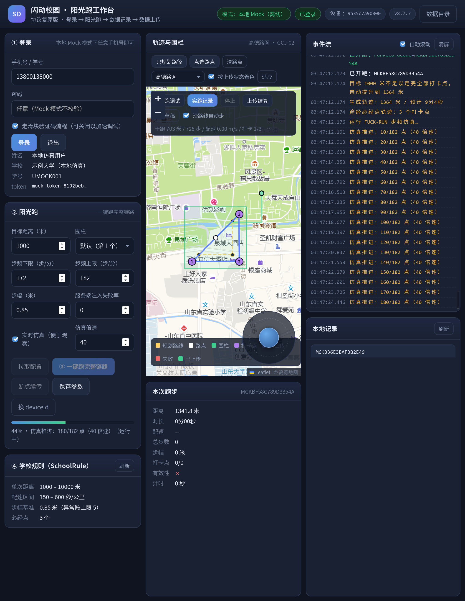
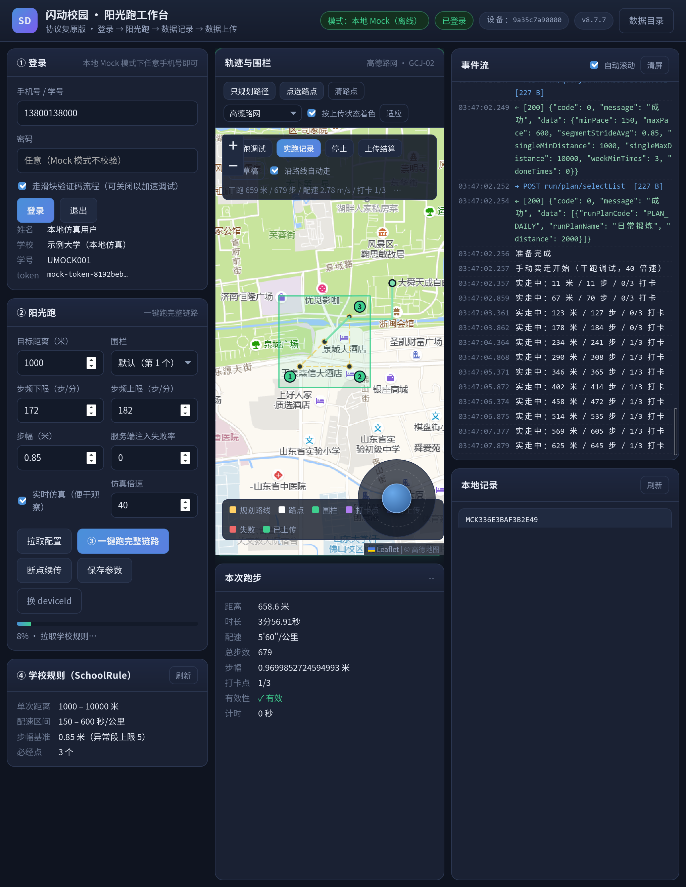

# 闪动校园·阳光跑 桌面工作台（shandong-run-lab）

一个用 Python 重写的**桌面程序**，把「闪动校园」（`com.huachenjie.shandong_school`）阳光跑的整条链路
从 App 里搬出来：**登录 → 选围栏/规则 → 开跑 → 轨迹与步频记录 → 分批上传 → 结算**，
并且内置一套**离线 Mock 服务端**与**传感器仿真器**（移植自 [FUCK-RUN-](https://github.com/BieFan1029/FUCK-RUN-)），
不开手机、不连服务器也能把全流程跑通、看数据、调参数。

界面是本地 Web（HTML/CSS/JS，无构建链），由 **pywebview** 装进原生窗口；没有 pywebview 时自动降级成
「本地 HTTP + 浏览器」，功能完全一致。

> ⚠️ **用途声明**：本项目仅用于**个人学习、协议研究与本地仿真调试**。请勿用于任何
> 影响真实校园跑数据、或与自身无关的账号。默认运行在 **Mock 模式**（纯本地，不发出任何真实请求）。

---

## 一、它能做什么

| 环节 | 能力 |
| --- | --- |
| 登录 | `loginCheck` → 滑块验证码（内置不依赖 OpenCV 的缺口求解）→ `loginPassword`；会话与 deviceId 持久化 |
| 备跑 | 拉学期、围栏列表（多边形）、阳光跑规则（配速/距离/打卡/步幅阈值）、跑量计划，解析成规则对象 |
| 开跑 | 九参数开跑报文，写入本地 SQLite（记录号、打卡点、围栏） |
| 记录 | 轨迹点（3 秒一采）、分段步数（3 秒一段）、分段配速、步幅、打卡点命中，全部落库 |
| 上传 | `uploadRunRecord`（★唯一需要签名的接口，分批 50 点）→ 分段步数/配速/步幅 → 打卡点 |
| 结算 | 一次性提交 `pois + stepList + paceList + runRecordCode`，服务端回 `status / invalidReasons` |
| 调试 | Mock 服务端（可注入延迟与随机失败率）、传感器仿真器（步频/抖动/丢包/暂停）、实时仿真（逐点推进，可在界面上看轨迹长出来）、事件流面板、本地记录浏览、JSON/GPX 导出 |
| 地图 | Leaflet 真实底图（高德路网/卫星、OSM、或关闭底图），围栏、打卡点、轨迹、规划路线矢量叠加；UI 自动验证布局与几何 |
| 手控 | **摇杆实走**（拖动摇杆 / 方向键逐帧推进位置与传感器，干跑不落库、实跑实时写库）；**只规划不动**（按打卡点最近邻连成闭环、或地图上点选路点，只画出来不升跑）；干跑/实跑结束后可一键上传结算 |
| 续传 | 断点续传：只补传「未成功」的点/段，含尾部补齐段 |

---

## 二、安装

需要 Python 3.10+（本机实测 3.14）。Arch Linux：

```bash
# 依赖（大多数系统已自带 requests/cryptography/Pillow）
sudo pacman -S --needed python-requests python-cryptography python-pillow

cd shandong-run-lab
python3 -m venv --system-site-packages .venv       # 继承系统包，省一次下载
.venv/bin/pip install pywebview                    # 桌面窗口（可选，缺了就自动走浏览器）
.venv/bin/pip install pycryptodome                 # 可选，密码学后端更快（没有则用 cryptography）
```

`pycryptodome` / `cryptography` / 纯标准库三种密码学后端会自动择优（见 `sdlab/ciphers.py`），
**全部缺失也能跑**（内置纯 Python AES）。

## 三、运行

```bash
# ① 桌面窗口（默认命令；Mock 模式，纯本地）
.venv/bin/python -m sdlab

# ② 不开窗口，用浏览器（端口随机，终端会打印地址）
.venv/bin/python -m sdlab gui --browser

# ③ 命令行跑一次完整流程（不开界面，适合脚本化 / 排错）
.venv/bin/python -m sdlab run -d 2000            # 2000 米
.venv/bin/python -m sdlab run -d 1500 --no-upload --json | tail -40

# ③′ 实时仿真：按真实时间推进数据写入，能在界面上看到轨迹一笔笔长出来（调试友好）
#     默认关闭（瞬间算完）。倍速 8 ≈ 真实跑步耗时的 1/8。
.venv/bin/python -m sdlab run -d 1200 --realtime --speed 8
# ④ 只起 Mock 服务端（给别的东西当靶子）
.venv/bin/python -m sdlab mock --port 8899 --latency 200 --fail-rate 0.3

# ⑤ 其它
.venv/bin/python -m sdlab info                   # 环境信息（后端、数据目录、默认目标）
.venv/bin/python -m sdlab login --prepare        # 登录并拉围栏/规则
.venv/bin/python -m sdlab records list           # 本地记录
.venv/bin/python -m sdlab records show --points  # 明细（含轨迹点）
.venv/bin/python -m sdlab records export MCKXXXX --format gpx
.venv/bin/python -m sdlab records resume MCKXXXX # 断点续传
.venv/bin/python -m sdlab check -v               # 跑自检（等价下面两脚本）
```

连真实服务器（请自行评估并自负后果）：

```bash
.venv/bin/python -m sdlab --real -p 手机号 -w 密码 run -d 2000
# 或临时用代理观察流量：
.venv/bin/python -m sdlab --proxy http://127.0.0.1:8080 gui
```

### 界面速览



> 上图是「一键跑」进行中的实拍（开启实时仿真，8 倍速）：中栏是**真实地图底图**（高德瓦片，
> 与记录坐标同为 GCJ-02，无需纠偏），围栏多边形、紫色编号打卡点与轨迹都叠加在底图之上，
> 轨迹按上传状态着色（已上传=绿、失败=红、待传=蓝），轨迹正一笔笔画出来。
>
> 
>
> 这张是**摇杆干跑**的实拍：右下角拖动摇杆（或按方向键）自己控制方向，轨迹实时长出来，
> 右栏事件流同步打印「实走中：X 米 / Y 步 / Z 打卡」；干跑全程**不升跑、不落库、不上传**。
>
> 另两张：`docs/screenshots/gui-1-init.png`（首屏）、`docs/screenshots/gui-3-done.png`（跑完结算）。


* **左栏**：登录/注销、模式切换、围栏选择、目标距离与仿真参数（步频区间、步幅、失败率）、
  一键备跑 / 开跑 / 续传、学校规则阈值。
* **中栏**：**真实地图 + 矢量叠加**——底图用 Leaflet 渲染（卡片头下方下拉可切：高德路网 /
  高德卫星 / OSM / 无底图；选择存在浏览器 localStorage，不写后端配置，右侧标签会同步显示
  当前底图与坐标系统），其上叠加围栏多边形、规划路线与路点、打卡点编号（命中后紫转绿）、
  按状态着色的轨迹。地图卡固定钉在**页面上半部**，显示区域随卡片尺寸自适应
  （卡片尺寸变化会自动 `invalidateSize`，不会有瓦片错位或留白）。
  下方是本次跑步的实时进度条与统计。
  勾选「实时仿真」后，跑步过程中地图**每隔约 1.4 秒自动重绘**，轨迹一笔笔长出来，
  「本次跑步」面板同步累计距离/步数——专门为观察逐点行为而做（默认关，关掉就是秒算完）。
* **中栏（手动）**：地图左上角的工具条与右下角的**摇杆**用于自己控制路径，不再是一键跑完：
  * **只规划路径**：按打卡点做最近邻排序连成一条闭环，或点「点选路点」在地图上依次点击，
    画出的路线只渲染（黄色折线 + 白色路点），**不升跑、不落库、不上传**。
  * **摇杆 / 方向键**：拖动摇杆（或按方向键）实时控制前进方向，位置、步数、步频、加速度
    逐帧推进；勾选「沿路线自动走」则沿规划路线自动巡航，推杆会自动接管。
  * **干跑调试**：只推位置与传感器数据，不升跑、不写库、不上传，专门用来调路径。
  * **实跑记录**：先开跑拿到 `runRecordCode`，轨迹实时写进本地 SQLite，停止后点
    「上传结算」走与一键跑完全相同的链路。
* **右栏**：事件流（请求/响应/状态/进度/Mock 注入分色显示）、本地记录列表与明细、
  导出 JSON/GPX、删除、打开数据目录。

---

## 四、数据与配置

| 内容 | 默认路径 |
| --- | --- |
| 配置 | `~/.config/shandong-run-lab/config.json` |
| 数据目录（SQLite / 导出） | `~/.local/share/shandong-run-lab/` （记录库 `records.db`） |
| 环境变量覆盖 | `SDLAB_HOME=/some/dir` 或 `--data-dir`（沙箱/便携场景用） |

数据库表：`runs`（记录头）、`points`（轨迹点）、`steps` / `paces`（分段）、`checkpoints`（打卡点）、
`upload_log` / `api_log`（上传与接口日志）、`kv`（会话与配置缓存）。WAL 模式，短连接，线程安全。

---

## 五、自检与测试

```bash
export SDLAB_HOME=$PWD/.run          # 沙箱内 ~/.local/share 只读时必加

# 单元测试（156 项）
.venv/bin/python -m unittest discover -s tests

# 端到端自检（36 项：密码学 / 仿真 / 全链路 / 失败注入+续传）
.venv/bin/python scripts/selfcheck.py -v

# 前端桥自检（37 项：用和浏览器一模一样的 HTTP 调用驱动后端，含摇杆干跑与规划）
.venv/bin/python scripts/webcheck.py

# 桌面外壳自检（真的开窗口、点界面按钮，断言中栏布局/地图几何，并验证只规划不跑与摇杆干跑）
.venv/bin/python scripts/gui_probe.py --distance 1200 --speed 8

.venv/bin/python -m sdlab check      # 两个自检一起跑
```

---

## 六、目录结构

```
shandong-run-lab/
├── sdlab/                  # Python 后端（可独立当库用）
│   ├── constants.py        #   全部常量/密钥/端点表的唯一出口
│   ├── ciphers.py          #   可插拔密码学原语（pycryptodome→cryptography→纯标准库）
│   ├── crypto.py           #   签名、字段加解密、滑块混淆、结算码、DES
│   ├── protocol.py         #   几何、打卡点、轨迹生成、有效性判定、报文构造
│   ├── simulator.py        #   传感器仿真（FUCK-RUN- 移植：加速度/步检测/步频漂移）
│   ├── net.py              #   HTTP 传输层（公共字段、UA、签名、Cookie、代理）
│   ├── walker.py           #   摇杆实走引擎（手动控向、沿路线巡航、采样、打卡）
│   ├── walk.py             #   实走会话（后台线程推进 + 增量落库 + 干跑/实跑）
│   ├── captcha.py          #   滑块验证码求解（无 OpenCV）
│   ├── client.py           #   业务门面：登录→备跑→开跑→上传→结算
│   ├── store.py            #   SQLite 记录库
│   ├── mock.py             #   离线 Mock 服务端（含服务端侧规则复核）
│   ├── engine.py           #   运行引擎：一次跑步的完整编排 + 断点续传
│   ├── bus.py              #   事件总线 + 配置存储
│   ├── app.py              #   GUI/CLI 共用的应用门面（含导出、记录管理）
│   ├── gui.py              #   pywebview 桌面外壳 / HTTP 降级
│   ├── cli.py              #   命令行
│   └── __init__.py, __main__.py
├── web/                    # 前端（原生 JS，无构建）
│   ├── index.html  ├── style.css  └── app.js
├── scripts/
│   ├── selfcheck.py        # 端到端自检
│   ├── webcheck.py         #   前端桥自检
│   └── gui_probe.py        #   桌面外壳冒烟（真开窗口、点按钮、断言布局）
├── tests/                  # 单元测试（crypto/protocol/simulator/store/walker/e2e）
└── docs/协议说明.md         # 协议与逆向要点
```

---

## 七、免责与致谢

* 协议细节来自对本机 APK `com.huachenjie.shandong_school` v8.7.7 的**静态分析**与
  **服务端常量交叉验证**（字段密文逐字节一致）。
* 仿真模块参考并移植了 [BieFan1029/FUCK-RUN-](https://github.com/BieFan1029/FUCK-RUN-)（Xposed 模块）的
  传感器伪造思路；工程组织参考了 [Inverx/com.huachenjie.shandong_school](https://github.com/Inverx/com.huachenjie.shandong_school)。
* 本项目与其作者无关，仅作学习研究；请在合法合规范围内使用。
